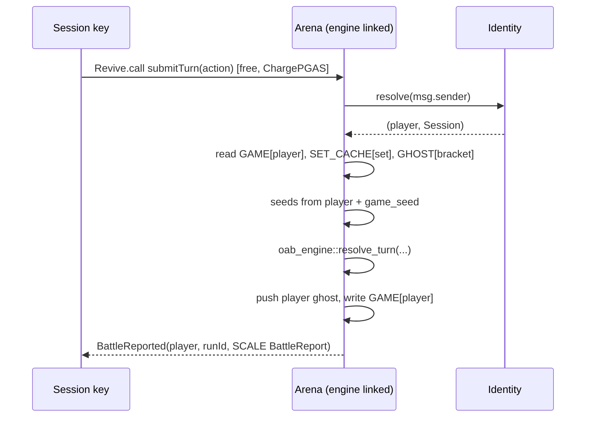
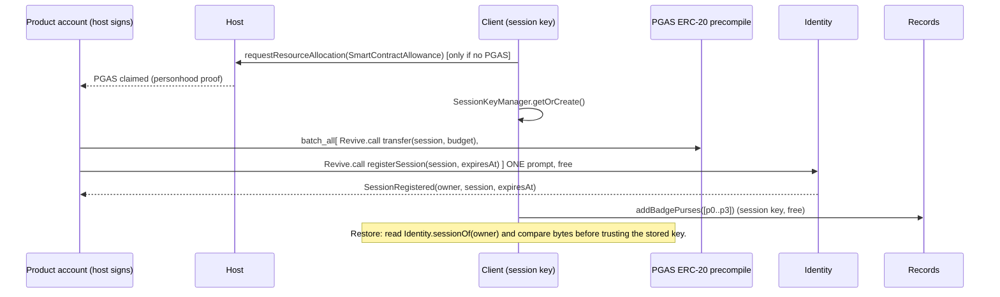
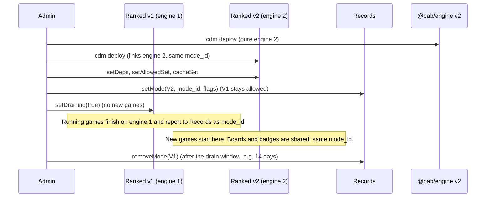
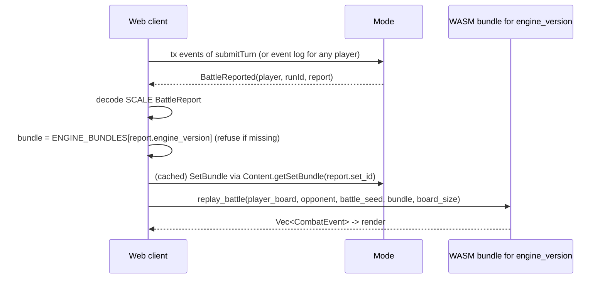

# OAB Contract Architecture (layered contracts)

Status: **design, not implemented.** Written 2026-10-20 against branch
`update/oct-2026` at `6569b91`. Shawn approved the direction (five contracts).
This document makes it concrete. It does not change any code.

All statements about current code cite a file. The code is the truth. If this
document and the code disagree, the code wins and this document is stale.

Tool versions checked on 2026-10-20:

- `cargo-pvm-contract`: `origin/main` is `d5991131`, the same rev the arena
  pins (`contract/Cargo.toml`). No newer SDK features exist on `main`.
- `contract-dependency-manager` (CDM): `origin/main` is `5ecde00`.
- Registry-session reference: `gaming-retreat-2026` `origin/main`,
  `.claude/skills/session-autosigning/references/`.
- Own-purse pattern: `paritytech/top-trumps` `main` at `4bf2295`.

## Contents

1. [Summary](#1-summary)
2. [Goals and non-goals](#2-goals-and-non-goals)
3. [The current system](#3-the-current-system)
4. [The five contracts](#4-the-five-contracts)
5. [Shared crates](#5-shared-crates)
6. [Who may call what](#6-who-may-call-what)
7. [Call flows](#7-call-flows)
8. [Hot-path cost](#8-hot-path-cost)
9. [Trust boundaries and failure modes](#9-trust-boundaries-and-failure-modes)
10. [Versioning and upgrades](#10-versioning-and-upgrades)
11. [Wiring and the frontend](#11-wiring-and-the-frontend)
12. [Governance](#12-governance)
13. [Migration from arena v2](#13-migration-from-arena-v2)
14. [Build plan](#14-build-plan)
15. [Where the direction meets the tooling](#15-where-the-direction-meets-the-tooling)
16. [Open questions](#16-open-questions)

---

## 1. Summary

Today one contract (`@oab/arena` v2, `contract/src/main.rs`) does everything:
card storage, casual games, ranked games, ghost pools, the personhood gate,
leaderboards, and badge NFTs. We split it into five layers:

```
                 ┌──────────────────────────────────────────────┐
  player ───────►│ Mode contracts (one per mode)                │
  (session key   │  Arena (casual) · Ranked · later: Pai Gow,   │
   or direct)    │  Constructed, Tournament                     │
                 │  own: games, ghost pools, set cache          │
                 │  link: oab-engine crate (no sub-call)        │
                 └──┬───────────────┬───────────────┬───────────┘
                    │ resolve       │ set bundle    │ report facts
                    ▼ (every call)  ▼ (once/set)    ▼ (end of run)
             ┌────────────┐  ┌────────────┐  ┌──────────────────┐
             │ Identity   │  │ Content    │  │ Records          │
             │ sessions,  │  │ cards,     │  │ leaderboards,    │
             │ personhood │  │ sets       │  │ achievements,    │
             └─────┬──────┘  │ (immutable │  │ badge collection,│
                   │         │  once      │  │ treasury         │
                   ▼         │  published)│  └────────┬─────────┘
          personhood         └────────────┘           ▼
          precompile 0x0A01                  Scarcity precompiles

             ┌───────────────────────────────────────────┐
             │ Engine contract (one per engine version)  │
             │ pure, no storage; for third parties and   │
             │ verification. Not on the game hot path.   │
             └───────────────────────────────────────────┘
```

The key rules:

- **The engine is a Rust crate first.** Modes link it. The engine contract is
  the same crate, deployed for others to call.
- **Content is immutable once published.** A mode copies a set into its own
  storage once. Turns never call Content.
- **Identity is the only sub-call on every game call.** It resolves a session
  key to the player.
- **Modes report facts. Records applies rules.** Records survives mode and
  engine upgrades.
- **Addresses come from the CDM registry at deploy time,** not on the hot path.

## 2. Goals and non-goals

### Goals

1. One meaning per achievement. "Flawless" means the same thing in every mode.
2. Leaderboards, badges, and the badge collection survive a new engine or a
   new mode.
3. A new engine version never breaks a game in flight. The game finishes on
   the engine it started with.
4. A client can replay any battle from chain data and the matching engine
   build.
5. Sign once, then play with no prompt and no fee (registry sessions on the
   `ChargePGAS` path). This replaces the proxy-session pool cost.
6. Ranked identity is the personhood alias. One person has one ranked
   identity.
7. New modes (Pai Gow, Constructed, Tournament) plug in without a change to
   Identity, Content, or Records code.
8. The game hot path (`submitTurn`) costs no more than today. Section 8 shows
   the expected numbers. We measure after implementation.

### Non-goals

- No implementation in this document.
- No change to the battle rules or card balance.
- No mainnet launch plan. Mainnet governance is listed, not designed.
- No user-created cards now. Content has an extension point only.
- No state migration from arena v2. Testnet state reset is accepted
  (section 13 lists what is lost).
- No new render layer or frontend redesign.

## 3. The current system

### 3.1 Arena v2 (`contract/src/main.rs`)

One `pvm-contract-sdk` contract, 2 405 lines with tests. Live at
`0xA61f803AeEBFfF2c7568157756932D3944EDCa28`, CDM `@oab/arena` version 2
(`contract/cdm.json`). Build blob about 112 KB (`contract/README.md`).

| Concern | Where in `contract/src/main.rs` |
| --- | --- |
| Game config (copy of `oab_game::GameConfig`) | `GameConfig`, `default_config` lines 29–58 |
| Game state | `ArenaSession` lines 60–74 (the `LocalGameState` fields plus `set_id`) |
| Storage model | SCALE blobs at `keccak256(domain ++ key)`, domains `DOM_*` lines 265–282, helpers lines 409–451 |
| Cards and sets | `register_card` 797–811, `register_set` 814–828, admin only, no overwrite |
| Card pool per call | `build_card_pool_from_storage` 738–746: one storage read **per card** |
| Seeds | `block_entropy` 764–786, `derive_seed` 748–756 (keyed by `msg.sender`) |
| Start | `start_session` 859–899 (bag, hand draw, shop-start triggers) |
| Turn | `submit_turn` 904–1079: verify, pick ghost, push ghost, battle, deltas, next shop, event |
| Ghost pools | `push_ghost` 686–704, `select_ghost` 706–736, 10 boards per bracket (line 77) |
| Bracket key | `bracket_bytes(set, round, wins, lives)` 290–298: **no casual/ranked flag** |
| Personhood | `abi_import!` of `IPersonhood` 96–109, `personhood_status` 503–513 (fails closed), `ranked_identity` 517–525 |
| Leaderboard | `LeaderboardEntry` 113–121, `insert_ranked` 133–150, top 100 per set, `record_ranked_result` 547–569 |
| Badges | `BadgeConfig`/`BadgeRecord` 214–228, `badge_purse` 587–601, `mint_badge` 606–625, `award_badges` 649–675, `init_achievements` 1140–1180, `claim_pending_badges` 1202–1221 |
| Battle event | `BATTLE_REPORTED_TOPIC` 285, packed bytes emitted at 1061–1076 |

Facts that shape the design:

- **Casual and ranked share ghost pools.** The bracket key has no mode flag
  (lines 290–298). A free casual account can plant weak ghosts that ranked
  players then meet.
- **The contract copies engine code.** `GameConfig` (lines 29–58) copies
  `game/src/lib.rs:31`. `create_starting_bag` (302–326) copies
  `game/src/sealed.rs:27`. `draw_hand` (328–350) copies `GameState::draw_hand`
  and `derive_hand_indices_logic` (`game/src/state.rs:208`, `:252`). The turn
  pipeline in `submit_turn` is not in any crate.
- **`make_shop_state` hard-codes `set_id: 0`** (line 358). The engine does not
  read it today, but it is wrong data.
- **The arena has no withdraw** and no Scarcity owner handover. Collection 30
  cannot leave arena v2 (`docs/NFT_DESIGN.md` §8 item 4, §9).
- **Seeds use `msg.sender`.** With registry sessions, `msg.sender` is the
  session key. The new modes must seed from the resolved player.

### 3.2 Engine crates

Real entry points (all `no_std`, SCALE types):

| Item | Signature / location |
| --- | --- |
| Turn validation | `pub fn verify_and_apply_turn(state: &mut ShopState, action: &CommitTurnAction) -> GameResult<()>` — `battle/src/commit.rs:406` |
| Shop start | `pub fn apply_shop_start_triggers(state: &mut ShopState)` — `battle/src/commit.rs:37` |
| Shop start after battle | `pub fn apply_shop_start_triggers_with_result(state: &mut ShopState, previous_battle_result: Option<BattleResult>)` — `battle/src/commit.rs:45` |
| Battle | `pub fn resolve_battle<R: BattleRng>(player_units: Vec<CombatUnit>, enemy_units: Vec<CombatUnit>, rng: &mut R, card_pool: &BTreeMap<CardId, UnitCard>, board_size: usize) -> Vec<CombatEvent>` — `battle/src/battle.rs:381` |
| Mana from battle | `pub fn player_shop_mana_delta_from_events(events: &[CombatEvent]) -> i16` — `battle/src/battle.rs:517` |
| Permanent stats | `pub fn player_permanent_stat_deltas_from_events(events: &[CombatEvent]) -> BTreeMap<UnitId, (StatValue, StatValue)>` — `battle/src/battle.rs:550` |
| Combat unit | `CombatUnit::from_card(card: UnitCard) -> Self` — `battle/src/battle.rs:235` |
| RNG | `XorShiftRng::seed_from_u64(seed: u64)` — `battle/src/rng.rs:44` |
| Starting bag | `pub fn create_starting_bag(set: &CardSet, seed: u64, bag_size: usize) -> Vec<CardId>` — `game/src/sealed.rs:27` |
| Hand draw | `GameState::draw_hand(&mut self, hand_size: usize)` — `game/src/state.rs:208` |
| Constructed deck check | `pub fn validate_deck(deck: &[u16], set: &CardSet, max_copies_per_card: usize, bag_size: usize) -> Result<(), String>` — `game/src/constructed.rs:39` |

Types: `CardSet { cards: Vec<CardSetEntry> }` (`battle/src/state.rs:29`),
`CardSetEntry { card_id: CardId, rarity: u8 }` (`:21`), `ShopState`
(`:42`), `UnitCard` (`battle/src/types.rs:514`), `BoardUnit` (`:571`),
`CommitTurnAction { actions: Vec<TurnAction> }` (`:623`), `GhostBoardUnit
{ card_id, perm_attack, perm_health }` (`:638`), `MatchmakingBracket`
(`:650`), `BattleResult` and `CombatEvent` (`battle/src/battle.rs:91`,
`:101`), `GameConfig` (`game/src/lib.rs:31`), `GamePhase`, `LocalGameState`,
`GameSession { state, set_id, config }` (`game/src/state.rs:24`, `:36`, `:64`).

Numbers measured on 2026-10-20 (SCALE, from `oab-assets`):

| Set | Cards | `CardSet` bytes | Card pool bytes |
| --- | --- | --- | --- |
| 0 Foundations of War | 49 | 148 | 1 531 |
| 1 The Hollow Swarm | 68 | 206 | 1 967 |
| 2 Fortune's Reckoning | 70 | 212 | 2 169 |

All 111 cards are 3 317 bytes. The largest card is 48 bytes.

### 3.3 The client

- `web/src/contract/index.ts` binds the arena from the inline address and ABI
  in `web/cdm.json` (lines 268–273, 439–446). It does no registry lookup at
  run time.
- `getGameState` appends a hard-coded `GameConfig` (`[3,10,3,10,0,5,5,50]`) to
  the `ArenaSession` bytes, because the WASM engine expects a `GameSession`
  (`index.ts` lines 581–586).
- Replay: `submitTurnOnChain` captures the **local** board before it submits
  (`web/src/store/contractStore.ts`), reads `battleSeed` and the opponent board
  from `BattleReported` (`index.ts` 832–885), then calls
  `engine.resolve_battle_p2p(playerBoard, opponentBoard, seed)`
  (`client/src/engine.rs:765`). That function rebuilds combat units itself. It
  copies the contract code (`contract/src/main.rs` 933–950, 723–733). The
  player board is not in the event, so a third party cannot replay a battle
  from chain data alone.
- Sponsored play uses **proxy sessions** (`web/src/contract/session.ts`).
  `Proxy.proxy` is outside the `ChargePGAS` filter, so every call pays a fee in
  PGAS through the thin DOT↔PGAS pool (`session.ts` header,
  `BETA_RELEASE_PLAN.md` "Sponsored-play scale").
- Personhood: the product account at derivation index 0 binds to an alias in
  OAB's context (`web/src/contract/personhood.ts`).

## 4. The five contracts

Conventions for all five:

- Built with `pvm-contract-sdk` at the pinned rev. Methods are `camelCase` in
  the ABI.
- Game data stays SCALE inside ABI `bytes`, as today
  (`contract/README.md` "Storage model"). Simple scalar config uses typed
  ABI arguments.
- Storage stays SCALE blobs at `keccak256(domain ++ key)` for game data.
  Fixed-size maps (addresses, config) may use the SDK `Mapping`/`Lazy`.
- Errors are typed (`#[derive(SolError)]`) instead of `0`/`false` returns.
  The reference registry does this
  (`gaming-retreat-2026` `reference-contract.md`).
- Events are `#[derive(SolEvent)]` with the player or alias as an indexed
  topic. Large game payloads stay one SCALE `bytes` field.
- No contract opts in to reentry. pallet-revive denies reentry by default
  (`cargo-pvm-contract` `crates/pvm-contract-core/src/call.rs`, doc on
  `CallBuilder`). No flow below needs a callback.

### 4.1 Engine

**Job:** turn `(state, action, opponent, seeds, content)` into
`(new state, events)`. Pure. No storage. No host calls except the input and
the return.

**Two forms, one source:**

1. **Crate `oab-engine`** (new, thin facade over `oab-battle` + `oab-game`).
   Modes link it. The WASM client links it. No sub-call on the hot path.
2. **Contract `@oab/engine`**, one deployment per engine version. It wraps the
   same crate. Third parties, tools, and auditors call it to check a result
   on chain. Modes never call it.

**Crate API (Rust):**

```rust
// engine/src/lib.rs  (new crate `oab-engine`)
pub const ENGINE_VERSION: u32 = 1;             // bump on any behavior change
pub const ENGINE_VECTORS_HASH: [u8; 32] = ...; // hash of golden-vector outputs, checked in

/// Everything one game needs from Content, resolved and pinned.
pub struct SetBundle {               // SCALE
    pub set_id: SetIdValue,
    pub set: CardSet,
    pub cards: Vec<UnitCard>,        // every card the set references
}
impl SetBundle {
    pub fn hash(&self) -> [u8; 32];  // keccak256(SCALE(self)); pins content
    pub fn card_pool(&self) -> BTreeMap<CardId, UnitCard>;
}

pub fn new_game(config: &GameConfig, bundle: &SetBundle, seed: u64) -> LocalGameState;

pub struct TurnInput<'a> {
    pub config: &'a GameConfig,
    pub pool: &'a BTreeMap<CardId, UnitCard>,
    pub state: LocalGameState,       // phase must be Shop
    pub action: CommitTurnAction,
    pub opponent: Vec<GhostBoardUnit>,
    pub battle_seed: u64,
    pub next_shop_seed: u64,
}
pub struct TurnOutput {              // SCALE
    pub state: LocalGameState,       // next Shop, or Completed
    pub result: BattleResult,
    pub player_board: Vec<GhostBoardUnit>, // board that fought (for replay + ghost)
    pub events: Vec<CombatEvent>,    // contracts may drop this; replay recomputes it
}
pub fn resolve_turn(input: TurnInput) -> Result<TurnOutput, GameError>;

pub fn board_to_units(board: &[Option<BoardUnit>], pool: &BTreeMap<CardId, UnitCard>) -> Vec<CombatUnit>;
pub fn ghost_to_units(ghost: &[GhostBoardUnit], pool: &BTreeMap<CardId, UnitCard>) -> Vec<CombatUnit>;
pub fn replay_battle(player: &[GhostBoardUnit], opponent: &[GhostBoardUnit],
                     seed: u64, pool: &BTreeMap<CardId, UnitCard>, board_size: usize) -> Vec<CombatEvent>;
```

`resolve_turn` is the body of today's `submit_turn` without storage, ghost
choice, or seed derivation (`contract/src/main.rs` 927–1057). `new_game` is
`start_session` without storage (859–899). The copies in the contract
(section 3.1) go away. The client's `resolve_battle_p2p` calls
`replay_battle`, so the client and the chain run the same unit setup.

Seeds and ghost choice stay in the mode. They are mode policy, not engine
rules.

**Contract ABI (`@oab/engine`, all `pure`):**

```solidity
function engineVersion() external pure returns (uint32);
function vectorsHash() external pure returns (bytes32);
// SCALE (GameConfig, SetBundle, u64 seed) -> SCALE LocalGameState
function newGame(bytes calldata input) external pure returns (bytes memory);
// SCALE (GameConfig, SetBundle, LocalGameState, CommitTurnAction,
//        Vec<GhostBoardUnit>, u64 battleSeed, u64 nextShopSeed) -> SCALE TurnOutput
function resolveTurn(bytes calldata input) external pure returns (bytes memory);
// SCALE (Vec<GhostBoardUnit> player, Vec<GhostBoardUnit> opponent, u64 seed,
//        SetBundle, u8 boardSize) -> SCALE Vec<CombatEvent>
function replayBattle(bytes calldata input) external pure returns (bytes memory);
```

No constructor arguments, no admin, no storage, no fallback (the
`nft-minter/src/main.rs` pattern). The caller passes the content, so the
engine contract never calls Content.

**Version identity.** One number, two checks:

- `ENGINE_VERSION: u32` is the identity. Modes store it in every game, put it
  in every event and every fact, and the frontend uses it to pick the WASM
  build.
- A golden-vector test (a fixed corpus of starts and turns over sets 0–2)
  hashes all outputs. The hash must equal `ENGINE_VECTORS_HASH`. If the
  behavior changes, the test fails until the author bumps `ENGINE_VERSION`
  and updates the hash. A comment-only change keeps the hash, so it needs no
  bump.
- The engine contract returns both values. A check script compares them with
  the crate and with each mode's `engineVersion()`.

We do not use a hash of the source files as the identity. It changes on
every comment edit and gives no meaning to a client.

### 4.2 Content registry (`@oab/content`)

**Job:** hold cards and sets. A published card or set never changes.

**Storage:**

| Domain | Key | Value |
| --- | --- | --- |
| `ADMIN` | () | admin address |
| `CURATOR` | address | `bool` |
| `CARD` | `card_id: u16` | SCALE `UnitCard` |
| `CARD_META` | `card_id` | SCALE `CardMeta { publisher: [u8;20], block: u64, origin: CardOrigin }` |
| `SET` | `set_id: u16` | SCALE `SetRecord { set: CardSet, hash: [u8;32], name: String, publisher, block }` |
| `NEXT_SET` | () | `u16` |

`CardOrigin` is `Curated` now. `Community { creator: [u8;20] }` is the
extension point for user-made cards (the pallet era had a creator hub,
`BETA_RELEASE_PLAN.md` "Pallet-era features"). Community cards would use a
separate id range (proposal: `0x8000..`), and modes decide whether they
accept a set that holds them.

**ABI:**

```solidity
// Curator. Reverts CardExists if the id is taken. Card bytes = SCALE UnitCard.
function publishCard(bytes calldata card) external;
// Curator. Every card must exist. Assigns the next set id. Returns (id, hash).
function publishSet(string calldata name, bytes calldata cardSet) external returns (uint16 setId, bytes32 setHash);
// Admin.
function setCurator(address who, bool allowed) external;

// Views.
function getCard(uint16 cardId) external view returns (bytes memory);        // SCALE UnitCard or empty
function getSet(uint16 setId) external view returns (bytes memory);          // SCALE CardSet or empty
function getSetBundle(uint16 setId) external view returns (bytes memory);    // SCALE SetBundle or empty
function setHash(uint16 setId) external view returns (bytes32);              // zero if absent
function setCount() external view returns (uint16);
```

**Events:** `CardPublished(uint16 indexed cardId, address publisher)`,
`SetPublished(uint16 indexed setId, bytes32 setHash, address publisher)`,
`CuratorSet(address indexed who, bool allowed)`.

`getSetBundle` is at most about 2.4 KB for today's sets (section 3.2), well
under the 16 KB read buffer the arena uses (`contract/src/main.rs:419`).

**Pinning.** A game stores `(engine_version, set_id, set_hash)`. Because a set
never changes, a mode may copy the bundle once and trust the copy. The hash
lets anyone check the copy against Content.

**Retiring a set** is mode policy (each mode has an allow list). Content
never deletes.

### 4.3 Identity and sessions (`@oab/identity`)

**Job:** answer two questions for every mode:

1. Which player does `msg.sender` act for? (session key → owner)
2. Is this player eligible for ranked play, and what is their alias?

Identity embeds the session registry. It is the reference registry
(`reference-contract.md`) plus expiry, burned keys, and personhood.

**Storage:**

| Field | Type |
| --- | --- |
| `admin` | `Lazy<Address>` |
| `session_of` | `Mapping<Address, Address>` (owner → session) |
| `owner_of` | `Mapping<Address, Address>` (session → owner) |
| `expires_at` | `Mapping<Address, u64>` (session → block) |
| `burned` | `Mapping<Address, bool>` (a key that was ever revoked or replaced) |
| `context` | `Lazy<[u8;32]>` personhood context |
| `accepted_tiers` | `Lazy<u8>` bitmask, bit 1 = Lite, bit 2 = Full |
| `max_ttl` | `Lazy<u64>` blocks |

**ABI:**

```solidity
// Owner only (a session key may not register a session). Revokes and burns any
// previous session of the caller. Reverts InvalidSessionKey, SessionKeyInUse,
// SessionKeyBurned, TtlTooLong.
function registerSession(address session, uint64 expiresAt) external;
// Owner only. Revokes and burns the caller's session.
function revokeSession() external;

// Hot path. kind: 0 = Direct (not a session key), 1 = Session (live),
// 2 = Invalid (expired, revoked, or burned). player = owner for kind 1,
// account for kind 0, zero for kind 2.
function resolve(address account) external view returns (address player, uint8 kind);

// Resolve, then ask the personhood precompile for the player in the configured
// context. tier = raw status; alias = zero unless the tier is accepted.
function rankedIdentity(address account) external view returns (address player, uint8 tier, bytes32 alias);
// Raw status for a player (no session resolution).
function personhoodOf(address player) external view returns (uint8 status, bytes32 alias);

function sessionOf(address owner) external view returns (address session, uint64 expiresAt);
function getConfig() external view returns (bytes32 context, uint8 acceptedTiers, uint64 maxTtl);

// Admin.
function setContext(bytes32 context) external;
function setAcceptedTiers(uint8 mask) external;
function setMaxTtl(uint64 blocks) external;
```

**Events:** `SessionRegistered(address indexed owner, address indexed
session, uint64 expiresAt)`, `SessionRevoked(address indexed owner, address
indexed session)`, `ConfigChanged(bytes32 context, uint8 acceptedTiers,
uint64 maxTtl)`.

**Session lifecycle:**

| Step | Who signs | Call | Fee |
| --- | --- | --- | --- |
| PGAS allowance | host prompt | `requestResourceAllocation(SmartContractAllowance)` | free (host claims PGAS with a personhood proof) |
| Create | product account, **one prompt** | `Utility.batch_all[ Revive.call(PGAS ERC-20 `transfer(session, budget)`), Revive.call(Identity.registerSession(session, expiresAt)) ]` | free: all-Revive batch passes `ChargePGAS` |
| Play | session key, no prompt | `Revive.call(mode.*)` | free; storage deposits still draw the session key's PGAS |
| Expire | nobody | `resolve` returns `Invalid` after `expiresAt` | — |
| Rotate | product account, one prompt | `registerSession(new, ...)`; old key is revoked and burned | free |
| Revoke | product account, one prompt | `revokeSession()` | free |
| Drain | session key | PGAS ERC-20 `transfer(owner, rest)` | free |

Source for the fee rules and the setup batch: `registry-sessions.md` §3–§5
and the skill's constant table (PGAS ERC-20 precompile
`0x7735940000000000000000000000000001200000`). That table says it was
checked live on 2026-07-14. **We did not check it again.** Milestone 2
checks it.

Two changes from the reference contract, on purpose:

- **Expiry.** The reference leaves expiry to extensions. We add
  `expiresAt` because the session mnemonic sits in plain host storage on
  Android (`registry-sessions.md` §2).
- **Burned keys.** The reference clears `owner_of` on revoke, so a revoked
  key would resolve to itself (kind `Direct`) and could play casual as a new
  player. We keep `burned`, and `resolve` returns `Invalid`.

**Ranked eligibility.** `rankedIdentity` replaces `ranked_identity`
(`contract/src/main.rs` 517–525) and keeps its rules: no context → not
eligible; precompile error → not eligible; only accepted tiers (Lite and Full
today, `PERSONHOOD_LITE`/`PERSONHOOD_FULL` lines 88–89) give an alias; a zero
alias is not eligible. The precompile is queried for the **resolved player**
(the product account), not the session key, because the product account holds
the `AliasAccounts` binding (`web/src/contract/personhood.ts` header).

**External dependency.** Ranked play is closed in practice today. The host
answers `NotAllowlisted` to the bind (`BETA_RELEASE_PLAN.md` "Open Items").
The fix is outside OAB: the `peopl.paseo` manifest must grant
`trustedProducts: {"oab-arena": ["context"]}` (host-rust-core
`runtime/capabilities/account.rs`, near line 170; reported by the
coordinator's top-trumps study, not read by the author of this document).
Identity cannot fix this. Milestone 3's ranked check needs it.

**Ownership reads (cosmetics, Constructed).** The NftPurse host API
(`docs/NFT_DESIGN.md` §7) is effectively dead on shipped hosts: vendored
only, with a trait-id collision (top-trumps study). Do not plan on it. The
working pattern is **own purses** (top-trumps `src/net/ownPurses.ts`):

- Root entropy from `deriveEntropy("<product>:purses:v1")` (exported by
  `@parity/product-sdk-host`, which OAB pins at `^0.27.1` in
  `web/package.json`).
- Purse keys on the soft path `product/<productId>/<i>`.
- The client scans purses `0..n` with a gap limit, reads the collection
  precompile `balanceOf` / `tokenOfOwnerByIndex` per purse, and never reuses a
  retired purse.
- Test vectors: top-trumps `scripts/handoff-vectors.mjs`.

Identity does not store purses. The client owns the scan. Records accepts a
player-supplied purse for badges (section 4.5). Constructed may verify a
purse on chain (section 4.4.4).

### 4.4 Mode contracts

**Job:** run one game mode. A mode owns its games, its ghost pools, and its
set cache. It links `oab-engine` and `oab-mode-kit` (section 5).

**Decision: casual and ranked are two contracts, `@oab/arena` and
`@oab/ranked`.** Reasons:

1. **Separate ghost pools.** Today both share brackets
   (`contract/src/main.rs` 290–298). A free bot account can plant weak boards
   that ranked players meet, which inflates the leaderboard. Two contracts
   give two pools by construction. Ranked ghosts come only from
   personhood-checked players.
2. **Records trusts them differently.** Records lets Ranked write leaderboards
   and earn badges. Arena gets neither. An allow-list entry per address is
   simpler than a per-report flag that a bug could set.
3. **Different upgrade pace.** Ranked will gain seasons and rule changes.
   Casual can stay put.

Cost: two deployments of the same code size (about 112 KB each today). One
contract with a flag and a flag in the bracket key would also fix point 1.
We prefer two because points 2 and 3 then need no extra code.

**Common storage (both modes, from `oab-mode-kit`):**

| Domain | Key | Value |
| --- | --- | --- |
| `ADMIN` | () | admin |
| `DEPS` | () | SCALE `Deps { identity, content, records: Option<[u8;20]> }` |
| `CONFIG` | () | SCALE `ModeConfig { mode_id: u16, game: GameConfig, allowed_sets: Vec<u16>, draining: bool }` |
| `SET_CACHE` | `set_id` | SCALE `SetBundle` (one read per turn instead of one per card) |
| `GAME` | player | SCALE `ModeGame` |
| `GHOST` | `MatchmakingBracket` SCALE | SCALE `Vec<Vec<GhostBoardUnit>>`, 10 per bracket |
| `RUN` | `run_id: u64` | SCALE `RunFact` (immutable once written) |
| `RUN_REPORTED` | `run_id` | `bool` |
| `NEXT_RUN` | () | `u64` |

```rust
pub struct ModeGame {                 // replaces ArenaSession; the client gets it as is
    pub run_id: u64,
    pub engine_version: u32,
    pub set_id: SetIdValue,
    pub set_hash: [u8; 32],
    pub config: GameConfig,           // no more hard-coded config in the client
    pub state: LocalGameState,
    pub alias: Option<[u8; 32]>,      // Ranked only
    pub started_block: u64,
}
```

**Common ABI:**

```solidity
function startGame(uint16 setId) external returns (uint64 runId);      // Arena
function submitTurn(bytes calldata action) external returns (uint64 battleSeed); // SCALE CommitTurnAction
function endGame() external returns (bool reported);
function abandonGame() external;

// Views take an explicit player. A dry-run origin may be a session key.
function getGame(address player) external view returns (bytes memory);   // SCALE ModeGame or empty
function getRun(uint64 runId) external view returns (bytes memory);       // SCALE RunFact or empty
function engineVersion() external pure returns (uint32);
function modeId() external view returns (uint16);

// Anyone. Re-sends a stored fact that Records did not accept.
function retryReport(uint64 runId) external returns (bool);

// Admin.
function setDeps(address identity, address content, address records) external;
function setAllowedSet(uint16 setId, bool allowed) external;
function setDraining(bool draining) external;   // no new games; running games finish
function cacheSet(uint16 setId) external;       // warm SET_CACHE at deploy
```

Errors: `NoGame`, `GameActive`, `WrongPhase`, `SetNotAllowed`,
`SetUnavailable`, `InvalidTurn`, `InvalidSession`, `NotEligible`, `Draining`.

**Events:**

```solidity
event GameStarted(address indexed player, uint64 runId, uint16 setId, uint32 engineVersion, bytes32 setHash);
// report = SCALE BattleReport (below)
event BattleReported(address indexed player, uint64 indexed runId, bytes report);
event GameEnded(address indexed player, uint64 indexed runId, uint8 wins, uint8 lives, uint8 rounds, bool reported);
event GameAbandoned(address indexed player, uint64 indexed runId);
```

```rust
pub struct BattleReport {             // SCALE, in BattleReported.report
    pub engine_version: u32,
    pub set_id: SetIdValue,
    pub round: RoundValue,            // the round that was fought
    pub result: BattleResult,
    pub wins: RoundValue,
    pub lives: RoundValue,
    pub battle_seed: u64,
    pub player_board: Vec<GhostBoardUnit>,   // new: replay needs no local state
    pub opponent: Vec<GhostBoardUnit>,
}
```

Today the event has no player topic and no player board
(`contract/src/main.rs` 1061–1076). Adding both costs about 30 bytes and lets
anyone replay any battle (flow 7.7).

#### 4.4.1 Arena (`@oab/arena`, casual)

- Open to every account. A `Direct` or `Session` caller plays as the resolved
  player. An `Invalid` session reverts.
- `endGame` reports a `RunFact` with `alias: None` when `records` is set.
  Records stores no board and mints no badge for it (rules in 4.5). See open
  question Q5.

#### 4.4.2 Ranked (`@oab/ranked`)

- `startRankedGame(uint16 setId) returns (uint64 runId)` calls
  `Identity.rankedIdentity(msg.sender)`. A zero alias reverts `NotEligible`.
  The alias goes into `ModeGame.alias`. Turns do not call the precompile again.
- `endGame` reports a `RunFact` with the alias.
- Ghosts come only from ranked games. Cold start: see open question Q6.

#### 4.4.3 Pai Gow (planned, `@oab/paigow`)

From `docs/PAI_GOW_VARIANT.md` "On-chain adaptation":

```solidity
function createMatch(uint16 setId) external returns (uint64 matchId);  // pack seed from block entropy
function joinMatch(uint64 matchId) external;
function commit(uint64 matchId, bytes32 commitment) external;         // keccak(SCALE(piles) ++ salt)
function reveal(uint64 matchId, bytes calldata piles, bytes32 salt) external;
function claimTimeout(uint64 matchId) external;                       // a side that did not reveal loses
function getMatch(uint64 matchId) external view returns (bytes memory);
```

Each pile pair resolves with `oab_engine::replay_battle`. The pairing seed is
`keccak(reveal_a ++ reveal_b ++ match seed)`. The fact kind is `Match` (4.5).

#### 4.4.4 Constructed (planned, `@oab/constructed`)

Deck checked with `validate_deck` (`game/src/constructed.rs:39`). The open
problem is ownership proof (`docs/NFT_DESIGN.md` §8 item 1): a card NFT sits at
a purse key, not at the player's account. Options:

1. **Signed purse claim.** The player's client signs
   `("oab/constructed/purse", mode, player, purse)` with the purse key. The
   mode checks the signature (pallet-revive has `sr25519_verify` and
   `ecdsa_recover` host functions; SDK support not checked) and then
   `ownerOf(token) == purse` on the collection precompile. Fits own purses
   (4.3). A purse moved later must be checked again at each start.
2. **Escrow.** The player moves the card to a purse the mode controls. Scarcity
   lets only the collection owner force-move, and one NFT sits per key, so
   return of the card is hard. Not preferred.
3. **Off-chain check, unranked only.** The client checks. No Records facts.

Recommendation: option 1. It needs a test that the host can sign with a purse
key. Open question Q10.

#### 4.4.5 Tournament (planned)

A mode with entry fees and a prize pool. It holds and pays its own funds and
reports facts to Records. Seasons are a Records concept (4.5), not a mode.
Open question Q9.

### 4.5 Records (`@oab/records`)

**Job:** turn facts into standing. Records owns leaderboards, achievement
rules, the soulbound badge collection, and the treasury that pays badge
deposits. It accepts facts only from allow-listed mode addresses. It keys
people by personhood alias.

**Fact type (in `oab-protocol`, section 5):**

```rust
pub struct RunFact {
    pub run_id: u64,                 // unique per mode address; idempotency key
    pub player: [u8; 20],            // resolved player (product account)
    pub alias: Option<[u8; 32]>,     // Some for personhood-checked runs
    pub set_id: SetIdValue,
    pub set_hash: [u8; 32],
    pub engine_version: u32,
    pub config: GameConfig,          // so rules can read wins_to_victory, starting_lives
    pub started_block: u64,
    pub ended_block: u64,
    pub kind: RunKind,
}
pub enum RunKind {
    Gauntlet { wins: u8, lives: u8, rounds: u8, outcome: RunOutcome },  // Arena, Ranked, Constructed
    Match { opponent_alias: Option<[u8; 32]>, lanes_won: u8, lanes_lost: u8 },  // Pai Gow
}
pub enum RunOutcome { Completed, Abandoned }
```

The mode id is **not** taken from the fact. Records reads it from the allow
list entry of `msg.sender`. A mode cannot report as another mode.

**Storage:**

| Domain | Key | Value |
| --- | --- | --- |
| `ADMIN` | () | admin |
| `MODE` | mode address | SCALE `ModeEntry { mode_id: u16, flags: u8 }` (flags: `RANKED`, `BOARDS`, `BADGES`) |
| `SEEN` | mode address ++ `run_id` | `bool` (dedupe) |
| `SEASON` | () | SCALE `Vec<Season { id: u16, start: u64, end: Option<u64> }>` |
| `BOARD` | `(mode_id, set_id, season)` | SCALE `Vec<LeaderboardEntry>`, top 100 (as today) |
| `BEST` | `(mode_id, set_id, season, alias)` | SCALE `LeaderboardEntry` |
| `RULES` | () | SCALE `Vec<BadgeRule>` |
| `BADGE_CONFIG` | () | SCALE `BadgeConfig { collection, items }` (as today) |
| `BADGES` | alias | SCALE `Vec<BadgeRecord>` |
| `PURSES` | alias | SCALE `Vec<[u8;20]>` queued fresh purses |
| `DEPS` | () | identity address |

```rust
pub struct BadgeRule {
    pub badge: u8,                   // index into BadgeConfig.items
    pub conditions: Vec<Cond>,       // all must hold
}
pub enum Cond {
    ReachedVictory,                  // wins >= config.wins_to_victory
    NoLifeLost,                      // lives >= config.starting_lives
    RankedMode,                      // ModeEntry.flags has RANKED
    ModeIs(u16),
    SetIs(u16),
}
pub struct BadgeRecord {
    pub badge: u8,
    pub set_id: SetIdValue,
    pub mode_id: u16,
    pub block: u64,
    pub purse: Option<[u8; 20]>,     // where it was minted
    pub token: Option<u64>,          // None = pending
}
```

Season 0 rules equal today's `qualifying_badges` (`contract/src/main.rs`
201–210): Victory = `[RankedMode, ReachedVictory]`; Flawless =
`[RankedMode, ReachedVictory, NoLifeLost]`. Because the rule reads the game
config from the fact, "Flawless" means "no life lost" in every mode, even one
with 5 lives.

**ABI:**

```solidity
// Allow-listed modes only. Idempotent per (mode, runId). Never reverts on a
// rule or mint problem; reverts only for NotAllowedMode or a bad payload.
function report(bytes calldata runFact) external returns (bool accepted);
// Anyone. Records calls mode.getRun(runId) and applies it (pull path,
// leaderboard-playground `arcade::record_score` style).
function pull(address mode, uint64 runId) external returns (bool accepted);

// Badge recipients (own purses, section 4.3). The caller is resolved through
// Identity to an alias. Appends fresh, empty purses to the alias's queue.
function addBadgePurses(address[] calldata purses) external;
// Anyone may retry; pending badges mint to queued purses (or the derived
// fallback when enabled). Returns how many minted.
function retryBadges(bytes32 alias) external returns (uint32 minted);

// Views.
function getLeaderboard(uint16 modeId, uint16 setId, uint16 season, uint32 offset, uint32 limit) external view returns (bytes memory);
function getPlayerRank(uint16 modeId, uint16 setId, uint16 season, bytes32 alias) external view returns (uint32);
function getBestRun(uint16 modeId, uint16 setId, uint16 season, bytes32 alias) external view returns (bytes memory);
function getBadges(bytes32 alias) external view returns (bytes memory);   // SCALE Vec<BadgeRecord>
function getBadgePurses(bytes32 alias) external view returns (address[] memory);
function derivedPurse(bytes32 alias, uint8 badge, uint16 setId) external view returns (address); // fallback / verifier
function getBadgeConfig() external view returns (bytes memory);
function getRules() external view returns (bytes memory);
function modeOf(address mode) external view returns (uint16 modeId, uint8 flags); // zero = not allowed
function currentSeason() external view returns (uint16);

// Admin.
function setMode(address mode, uint16 modeId, uint8 flags) external;
function removeMode(address mode) external;
function setRules(bytes calldata rules) external;            // SCALE Vec<BadgeRule>
function startSeason(uint16 id) external;                    // closes the open season
function initAchievements() external returns (uint32 collection);
function defineBadge(bytes calldata key, bytes calldata name) external returns (uint8 badge); // new soulbound item
function setDerivedFallback(bool enabled) external;
function nominateCollectionOwner(address newOwner) external; // handover to a Records v2
function withdraw(address to, uint256 amount) external;
function setIdentity(address identity) external;
// Funding: plain value transfer to the contract (payable receive/fund).
function fund() external payable;
```

**Events:** `RunRecorded(bytes32 indexed alias, address indexed mode,
uint64 runId, uint16 modeId, uint16 setId, uint16 season, uint32 rank)`,
`RunIgnored(address indexed mode, uint64 runId, uint8 reason)`,
`BadgeMinted(bytes32 indexed alias, uint8 badge, uint16 setId, address purse,
uint256 tokenId)`, `BadgePending(bytes32 indexed alias, uint8 badge, uint16
setId)`, `ModeSet(address indexed mode, uint16 modeId, uint8 flags)`,
`RulesSet(bytes32 rulesHash)`, `SeasonStarted(uint16 id, uint64 block)`,
`Funded(address from, uint256 amount)`, `Withdrawn(address to, uint256
amount)`.

**Rules Records applies to a fact:**

1. `msg.sender` must be in `MODE`. Else revert `NotAllowedMode`.
2. Seen `(mode, run_id)` → return `false` (no double count, safe retries).
3. `alias == None` or `Abandoned` → record nothing, emit `RunIgnored`.
4. Mode has `BOARDS` → update `BEST` and `BOARD` for
   `(mode_id, set_id, current season)` with `insert_ranked`
   (`contract/src/main.rs` 133–150).
5. Mode has `BADGES` → evaluate `RULES`. At most one record per
   `(alias, badge, set)`. This makes badges **per person**, not per account
   (resolves `docs/NFT_DESIGN.md` §8 item 7 in the direction of the alias;
   see Q4).
6. Mint each new badge. A failed mint leaves `token: None` and emits
   `BadgePending`. Rule 4 is already stored, so a mint failure never loses the
   result.

**Badge recipients (own purses).** Today the arena mints each badge to a
keyless key `keccak256("oab/badge-purse/" ++ arena ++ player ++ badge ++
set)[12..]` (`contract/src/main.rs` 587–601). Nobody controls those keys, so
the badges never show in a player's purse scan. Records changes this:

- The client derives fresh purses (section 4.3) and calls
  `addBadgePurses([...])` once per session setup, for example 4 purses. This
  call goes through the session key, so it is free.
- At mint time Records takes the first queued purse, checks
  `balanceOf(purse) == 0` on the collection precompile (one NFT per key,
  `docs/NFT_DESIGN.md` §2), mints to it, and removes it from the queue. A
  purse is never used twice.
- No queued purse → the badge stays pending. `retryBadges(alias)` mints it
  after the client adds a purse. With `setDerivedFallback(true)`, Records
  mints to `derivedPurse(alias, badge, set)` instead. The derived formula
  also serves as a verifier for fallback badges.
- A wrong purse (one the player does not control) only hurts the player. The
  badge is soulbound and the record in `BADGES` stays keyed by alias, so the
  record is the source of truth for "who earned it".

**Treasury.** Records pays the collection deposit (1.80 PAS) and about
0.21 PAS per badge (`docs/NFT_DESIGN.md` §9). It has `fund` and an admin
`withdraw`. Arena v2 has no withdraw, so its balance is stuck (section 13).

## 5. Shared crates

Shared code lives in crates, not in a shared contract.

| Crate | Content | Used by |
| --- | --- | --- |
| `oab-battle`, `oab-game` (exist) | rules | `oab-engine` |
| `oab-engine` (new) | facade of 4.1, `ENGINE_VERSION`, golden vectors | modes, engine contract, WASM client |
| `oab-protocol` (new) | SCALE types that cross a contract boundary: `SetBundle`, `ModeGame`, `BattleReport`, `RunFact`, `LeaderboardEntry`, `BadgeRecord`, `BadgeRule`, `BadgeConfig`; ABI `abi_import!` blocks of Identity, Content, Records, mode `getRun`; frontend fixture test | all contracts, client codec tests |
| `oab-mode-kit` (new) | raw SCALE storage helpers (today's `skey`/`read_scale`/`write_scale`, `contract/src/main.rs` 409–451), seed derivation (`block_entropy`, `derive_seed`), ghost pools, set cache, start/turn/end skeleton, report-with-retry | mode contracts |

`oab-protocol` takes over the fixture test that pins the frontend decoders
(`frontend_scale_fixtures`, `contract/src/main.rs` 2334–2404).

## 6. Who may call what

| Caller ↓ / Callee → | Engine | Content | Identity | Arena / Ranked | Records | Scarcity | Personhood pc |
| --- | --- | --- | --- | --- | --- | --- | --- |
| Player, session key | views | views | views | game calls | `addBadgePurses`, `retryBadges`, `pull`, views | — | — |
| Player, product account | views | views | `registerSession`, `revokeSession` | game calls | same as session | — | — |
| Curator | — | `publishCard`, `publishSet` | — | — | — | — | — |
| Admin (deploy key) | — | `setCurator` | config | config, `setDraining`, `cacheSet` | allow list, rules, seasons, treasury, collection | — | — |
| Arena / Ranked | — (linked) | `getSetBundle` (cold) | `resolve`, `rankedIdentity` | — | `report` | — | — |
| Identity | — | — | — | — | — | — | `personhoodStatus` |
| Records | — | — | `rankedIdentity` (purse queue) | `getRun` (pull) | — | `createCollection`, `defineItem`, `mint`, `balanceOf`, owner handover | — |
| Anyone / third party | all | views | views | views, `retryReport` | views, `pull`, `retryBadges` | views | — |

Nested depth is at most 3 (player → mode → Records → Scarcity). No path calls
back into a contract that is already on the stack. `pull` runs Records →
mode, but the mode is not on the stack then.

## 7. Call flows

### 7.1 Casual turn (hot path)



### 7.2 Ranked start

```mermaid
sequenceDiagram
    participant S as Session key
    participant R as Ranked
    participant I as Identity
    participant P as Personhood precompile
    participant C as Content
    S->>R: startRankedGame(setId)
    R->>I: rankedIdentity(msg.sender)
    I->>I: resolve session -> player
    I->>P: personhoodStatus(player, context)
    P-->>I: (status, alias)
    I-->>R: (player, tier, alias or zero)
    alt alias is zero
        R-->>S: revert NotEligible
    else eligible
        opt SET_CACHE[setId] missing (only once per set per mode version)
            R->>C: getSetBundle(setId)
            C-->>R: SetBundle
            R->>R: check hash == Content.setHash, store
        end
        R->>R: seed = f(block entropy, player); oab_engine::new_game
        R-->>S: GameStarted(player, runId, setId, engineVersion, setHash)
    end
```

### 7.3 End of game, report, badge mint

```mermaid
sequenceDiagram
    participant S as Session key
    participant R as Ranked
    participant I as Identity
    participant RC as Records
    participant N as Scarcity collection
    S->>R: endGame()
    R->>I: resolve(msg.sender)
    R->>R: phase == Completed; push final ghost
    R->>R: write RUN[runId] = RunFact; clear GAME[player]
    R->>RC: report(RunFact)  [bounded gas, error is caught]
    RC->>RC: allow list, dedupe, BEST/BOARD update
    RC->>RC: evaluate rules -> new badges
    RC->>N: balanceOf(purse)==0 ? mint(item, purse, oab.set)
    N-->>RC: tokenId (or error -> pending)
    RC-->>R: accepted
    R->>R: RUN_REPORTED[runId] = true
    R-->>S: GameEnded(player, runId, wins, lives, rounds, reported)
    Note over R,RC: If report fails: game still ends, reported=false.<br/>Anyone calls Ranked.retryReport(runId) or Records.pull(Ranked, runId).
```

### 7.4 Session setup



### 7.5 Content publish

```mermaid
sequenceDiagram
    participant Cu as Curator
    participant C as Content
    participant Ad as Admin
    participant M as Mode
    Cu->>C: publishCard(UnitCard) x N  (batch_all of Revive calls)
    Cu->>C: publishSet(name, CardSet)
    C-->>Cu: SetPublished(setId, setHash)
    Ad->>M: setAllowedSet(setId, true)
    Ad->>M: cacheSet(setId)   (warm cache; else first player pays it)
```

### 7.6 Engine upgrade with games in flight



Because modes link the engine, an engine upgrade is a mode redeploy.
Section 15 explains why.

### 7.7 Client battle replay



## 8. Hot-path cost

Frequent calls: `submitTurn` (about 10–20 per run), `startGame` (1 per run),
`endGame` (1 per run). Proof size (PoV) on a parachain grows with every
contract code blob the call loads and every storage item it touches.

| Call | Code blobs loaded | Sub-calls | Storage reads / writes |
| --- | --- | --- | --- |
| **Today** `submitTurn` (`contract/src/main.rs` 904–1079) | arena (~112 KB) | none | session, set, **1 per card** (49–70), ghost pool / session, ghost pool |
| **New** `submitTurn` | mode (~112 KB est.) + Identity (est. 5–15 KB) | `Identity.resolve` | game, `SET_CACHE` (1 blob ≤ 2.4 KB), ghost pool, Identity 2–3 small items / game, ghost pool |
| Today `startRankedGame` | arena | personhood precompile | session flag, set, 1 per card / session, ranked flag |
| New `startRankedGame` | mode + Identity | `rankedIdentity` → precompile; `getSetBundle` only on a cold cache | as turn, plus Content code (cold only) |
| New `endGame` (ranked) | mode + Identity + Records (est. 40–80 KB) | `resolve`, `report` → Scarcity `balanceOf` + `mint` ×0–2 | run fact, ghost / Records: board (≤ 4.6 KB), best, badges, purses |
| Engine contract call | engine (~ size of the engine part of the mode) | none | none |

Expected result: `submitTurn` adds one small sub-call and removes 48–69
storage reads. It should cost the same or less than today. `endGame` costs
more (Records code), but it runs once per run.

**Avoid on the hot path:**

- `cdm::import!`'s `cdm_lookup()`. It calls the CDM registry
  (`getAddress(string)`) at run time, returns the **latest** version, and
  panics on failure (CDM `src/lib/cdm/rust-macros/pvm-cdm-macros/src/lib.rs`
  lines 53–162). That is one extra sub-call plus the registry code per use.
  Modes store dependency addresses in `DEPS` instead (section 11).
- Calling the engine contract. It would load a second ~100 KB blob per turn.

**Measure after implementation (milestone 3 and 4 success criteria):**
dry-run `gasRequired` (ref time and proof size) for `startGame`,
`startRankedGame`, `submitTurn` (round 1 and round 10, with a full ghost
bracket), and `endGame` (no badge, one badge, two badges). Compare with arena
v2 on the same chain. The client already doubles dry-run weight for game
starts (`web/src/contract/arenaFlows.ts` `withGasHeadroom`); check that the
margin still holds. Also measure the largest `BattleReported` event and the
engine contract's `replayBattle` return size, because return buffer limits
were not checked.

## 9. Trust boundaries and failure modes

**Trust:**

- Records trusts every fact from an allow-listed mode. A buggy mode can write
  false boards. Mitigation: allow-list per address, `removeMode`, and facts
  stored in the mode (`getRun`) so an audit can recompute them with the
  engine contract.
- Modes trust Identity for "who is this". A wrong Identity address lets
  anyone act as anyone. `setDeps` is admin-only and emits an event.
- Modes trust Content only at cache time, and they check the hash.
- Identity trusts the personhood precompile.
- Nobody trusts the engine contract. Modes do not call it.

**Failure modes:**

| Failure | Effect | Rule |
| --- | --- | --- |
| `Records.report` reverts or runs out of gas | Game still ends. `GameEnded.reported = false`. Fact stays in `RUN`. | The mode calls Records with a bounded gas limit (`CallLimits`) and catches the error. Anyone calls `retryReport` or `Records.pull`. Dedupe makes retries safe. |
| Badge mint fails (no funds, no collection, purse not empty) | Board entry kept, badge `token: None`, `BadgePending`. | `retryBadges(alias)` after funding or after new purses. Same rule as today (`contract/src/main.rs` 646–675). |
| No queued purse | Badge pending. | Client adds purses; or admin enables derived fallback. |
| Identity call fails, ranked | `startRankedGame` reverts. | Fail closed (as today, `contract/src/main.rs` 500–513). |
| Identity call fails, casual | See Q3. Proposal: fail closed for a caller that looks like a session (no way to know), so **revert**. | A contract cannot go "down"; a failure here means a bad address or a bug. Revert is the safe answer. |
| Session expired or burned | Mode reverts `InvalidSession`. Client sets up a new session (one prompt). | |
| Content missing a set | `startGame` reverts `SetUnavailable`. Running games are not affected (they use the cache). | |
| Personhood precompile missing on a chain | Ranked closed. Casual open. | As today. |
| Records full of stale modes | `modeOf` returns zero for removed modes; their reports revert. | |

## 10. Versioning and upgrades

| Contract | Changes how | State on upgrade |
| --- | --- | --- |
| Engine | New version = new deployment of `@oab/engine` (new CDM version) | none (pure) |
| Content | Code immutable. New cards and sets are appended. | kept forever |
| Identity | Redeploy, then `setDeps` on every mode and `setIdentity` on Records. | sessions lost: one prompt per player |
| Mode | New engine or new mode logic = new deployment with the same `mode_id`. Old one drains. | games finish on the old one; ghost pools start empty (Q1) |
| Records | Immutable code at first. Escape hatch: `nominateCollectionOwner` to a Records v2. See Q8 for a proxy. | boards and badges must be migrated or restarted |
| nft-minter | Immutable (`nft-minter/src/main.rs` header). New table = new minter. | none |

**Engine version rule.** Any change that alters a golden-vector output bumps
`ENGINE_VERSION`. A new engine version means: new `@oab/engine` deploy, new
mode deploys, new WASM bundle in the frontend. A game never changes engine
version.

**Frontend needs:**

- A table `ENGINE_BUNDLES: Record<number, () => Promise<WasmModule>>`, one
  `wasm-pack` output per engine version still in play (`build-wasm.sh` today
  builds one). Lazy-load old bundles. Bundle size was not measured; check it
  against the Bulletin limit before keeping more than two.
- `getGame` returns `engine_version`. The client loads that bundle for the
  shop phase and replay. If it has no bundle, it shows "update the app" and
  does not submit.
- The client stops patching config bytes (`index.ts` 581–586), because
  `ModeGame` carries `config`.
- A CI check: the WASM `engine_version()` export equals the crate constant,
  and every mode in `web/cdm.json` reports an engine version that has a
  bundle.

## 11. Wiring and the frontend

**Contracts.** `cdm::import!` gives two resolvers (CDM `pvm-cdm-macros`):

- `cdm_lookup()`: run-time registry call, latest version, panics on failure.
- `cdm_from_env()`: address baked at build time from `CDM_REGISTRY`.

Design: each mode keeps its dependencies in `DEPS`. The deploy script fills
them right after `cdm deploy`, with addresses from the registry
(`getAddressAtVersion`, an exact version, not "latest"). `setDeps` emits an
event. This keeps the hot path free of registry calls, pins exact versions,
and lets the admin re-point a mode. `cdm::import!` is still used for the
typed interfaces. Its `cdm_from_env()` is acceptable for a constructor
default.

**Package names:** `@oab/engine`, `@oab/content`, `@oab/identity`,
`@oab/arena` (version 3 = casual mode; the ABI changes, but the frontend pins
versions in `cdm.json`), `@oab/ranked`, `@oab/records`. `@oab/nft-minter`
stays.

**Frontend.** `cdm i -n paseo @oab/content @oab/identity @oab/arena
@oab/ranked @oab/records` writes all addresses and ABIs into
`web/cdm.json`. The client binds each from the inline address and ABI, as it
does today (`index.ts` 268–273), so `connect()` stays free of registry
lookups. `ContractManager.getContract("@oab/...")` from
`@parity/product-sdk-contracts` is the typed path (CDM README "Using
Contracts From A Triangle App").

Client changes:

- `session.ts`: proxy sessions → registry sessions (flow 7.4). The
  `Sponsor` policy object stays; `ProxySession` becomes a `RegistrySession`.
  On first run after the switch, offer `Proxy.remove_proxies` to return the
  proxy deposit.
- Dry-runs use the session key as origin, so `resolve` sees the same caller as
  the real call.
- Views pass the player address explicitly.
- `codec.ts` decodes `ModeGame`, `BattleReport`, `RunFact`, and the Records
  views from `oab-protocol` fixtures.
- Own purses for badges and cosmetics (section 4.3).

## 12. Governance

| Stage | Who holds admin |
| --- | --- |
| Testnet (now) | the cdm deploy key (`docs/NFT_DESIGN.md` §1 owner account) |
| Before mainnet | a multisig or a governance origin for: Content curators, Identity config, mode config, Records allow list, rules, seasons, treasury, collection owner |

Immutable after deploy:

- Every engine contract (no storage, no admin).
- Every published card and set in Content.
- Mode code per version (config stays mutable).
- `nft-minter`.

Mutable (admin):

- Content curator list.
- Identity context, accepted tiers, max TTL.
- Mode deps, allowed sets, draining.
- Records allow list, rules, seasons, derived fallback, treasury, collection
  handover, Identity address.

Every admin setter emits an event, so changes are visible on chain.

## 13. Migration from arena v2

Testnet only. A state reset is accepted. Arena v2 stays deployed (a contract
cannot be removed). The frontend stops pointing at it.

**What is lost or stranded:**

| Item | Where in v2 | Fate |
| --- | --- | --- |
| Games in progress | `DOM_SESSION` | Not moved. Players can finish them only with an old frontend. Proposal: announce, then switch. |
| Ghost pools | `DOM_GHOST` | Lost. v2 has no view for them. They could be read off chain through raw storage and seeded by an admin (Q6). |
| Leaderboards, best runs | `DOM_LEADERBOARD`, `DOM_BEST_RUN` | Lost. Readable through `getLeaderboard`. Likely empty: ranked play is blocked by the bind (`BETA_RELEASE_PLAN.md`). |
| Badge records | `DOM_BADGES` | Lost. Likely empty for the same reason. |
| Collection 30 | owned by v2 | Stranded. v2 has no owner handover. Existing badges stay valid in it. Records creates a new collection. |
| Arena v2 PAS balance | arena account | Stranded. v2 has no withdraw (`docs/NFT_DESIGN.md` §8 item 4). |
| Proxy sessions | `Proxy` pallet, per player | Still valid but unused. The client offers to remove them. |

**Kept:** personhood bindings (pallet `AliasAccounts`, not contract state),
the personhood context value (product-scoped, unchanged while the product id
is `oab-arena.paseo`), collection 29 and `@oab/nft-minter`, card and set data
(re-published from `assets/` into Content; set ids are auto-assigned in order,
so 0, 1, 2 stay the same if published in order).

## 14. Build plan

Order agreed: content + engine → identity → modes → records → frontend →
retire arena v2. Each milestone ends with its success criteria met.

**Priority change (2026-10-20):** casual play for everyone comes first.
Build M1, M2 (sessions; the personhood part of Identity can wait), and M3 with
the Arena mode only. The Ranked mode, M4 Records, and the personhood bind are
on hold.

### M1. Engine crate, engine contract, Content

Work:

1. Create `oab-engine` (4.1). Move the turn pipeline out of
   `contract/src/main.rs` into `resolve_turn`. Delete the copies of
   `GameConfig`, `create_starting_bag`, `draw_hand` from the contract. Fix
   `set_id: 0` in `make_shop_state`.
2. Point arena v2 source and the WASM client at the facade (no redeploy).
3. Golden vectors, `ENGINE_VERSION = 1`, `ENGINE_VECTORS_HASH`.
4. `@oab/engine` contract. `@oab/content` contract. `oab-protocol` crate.

Success:

- All current native tests in `contract/src/main.rs` and
  `contract/tests-native/` pass with the facade, unchanged.
- The golden vectors give the same outputs as arena v2 code before the
  refactor (proof that the refactor changed no behavior).
- On Paseo Next: 111 cards and 3 sets published; `setHash(i)` equals the hash
  computed off chain; `@oab/engine.resolveTurn` dry-run output equals the
  native output for the corpus; `engineVersion()` = 1.

### M2. Identity

Success:

- MockHost tests: register, rotate (old key burned), revoke, expiry,
  session cannot register, burned key returns `Invalid`, TTL limit, tier mask,
  fail closed with no context, with a reverting precompile, and with an empty
  reply (the current tests at `contract/src/main.rs` 1730–1818 move here).
- On Paseo Next: the all-Revive setup batch costs the product account no fee;
  a session-signed `Revive.call` into a test contract that calls `resolve`
  costs no fee and resolves to the owner.

### M3. Arena and Ranked modes

Success:

- Native end-to-end tests equal to today's (`e2e_full_game_lifecycle_to_defeat`
  and the ranked tests), now with Identity mocked.
- Ranked ghosts never come from Arena games (test).
- On Paseo Next: a full casual run signed only by a session key with zero fee;
  `BattleReported` replays in a script from chain data alone.
- Dry-run weights recorded for the calls in section 8, side by side with arena
  v2. `submitTurn` proof size is not higher than arena v2's.
- Ranked start succeeds for a bound account, after `peopl.paseo` allowlists
  OAB (external dependency, 4.3). If that is still blocked, record it and
  test with MockHost only.

### M4. Records

Success:

- Report from a non-listed address reverts; a repeated `run_id` is ignored.
- Season 0 rules give the same badges as `qualifying_badges` today.
- A failed report leaves the game ended; `retryReport` and `pull` both work
  once.
- Badge mints go to queued own purses; a non-empty purse is skipped; no
  purse → pending → `retryBadges` mints after `addBadgePurses`.
- `withdraw` and `nominateCollectionOwner` work (on chain, small amounts).
- `endGame` dry-run weight recorded with 0, 1, and 2 badges.

### M5. Frontend

Success:

- `web/cdm.json` holds all new packages. Registry sessions replace proxy
  sessions. One prompt to start, no prompt and no fee per turn, checked in a
  host.
- Replay uses `ENGINE_BUNDLES[engine_version]` and the event's player board.
- Leaderboard and badges read Records. Badges show from own purses.
- `npm test` and the codec fixture tests pass.

### M6. Retire arena v2

Success:

- The deployed frontend has no reference to arena v2.
- `docs/CURRENT_ARCHITECTURE.md`, `agents/ARCHITECTURE.md`,
  `contract/README.md`, `docs/NFT_DESIGN.md`, and `BETA_RELEASE_PLAN.md`
  describe the new contracts.
- The client offers proxy removal to players who still have one.

## 15. Where the direction meets the tooling

These are places where the agreed direction and the code or tools pull apart.
The design above picks one answer for each. Shawn should confirm.

1. **Per-game engine version vs a linked engine.** The direction says each
   game stores its engine version and finishes on it. With the engine linked
   into the mode (the agreed nuance), one mode deployment holds exactly one
   engine version. So "finish on the old version" means "finish on the old
   mode deployment", and every engine upgrade is a mode redeploy (flow 7.6).
   Linking two engine versions into one mode would need two renamed copies of
   the crates and about twice the code size. We do not recommend it.
2. **CDM run-time lookup is "latest" only.** `cdm_lookup()` calls
   `getAddress(string)`, which returns the latest version, and it panics on
   failure. The registry has `getAddressAtVersion`, but the macro does not use
   it. Pinning engine or dependency versions at run time is not supported, and
   the lookup costs a sub-call. The design stores addresses (section 11).
3. **`#[slot(raw)]`.** At `d5991131` the form is `#[slot(raw = KEY)]`; a bare
   `#[slot(raw)]` is a parse error (`pvm-contract-macros` tests). The SDK
   provides only the slot. The EIP-1967 example
   (`crates/pvm-contract-macros/tests/native_proxy_slot.rs`) stores the
   implementation address but does not forward calls. A forwarding proxy
   (fallback + `delegate_call`) would be our code and is untested. The host
   API has no `set_code_hash`.
4. **No reentrancy guard macro.** The SDK relies on pallet-revive's default
   (reentry denied) and offers `allow_reentry()` per call. That is enough for
   this design.
5. **Registry sessions have no expiry in the reference.** Expiry and burned
   keys are our extension (4.3).
6. **The free-call claim is from July.** `ChargePGAS` covering Revive calls
   and all-Revive batches was checked live on 2026-07-14 by the skill authors.
   This document did not check it again. M2 does.
7. **Records keyed by alias.** Casual players without personhood have no
   alias, so Records cannot rank them. The design ignores alias-less facts.
8. **Badges per person.** Keying by alias makes badges one per person. The
   current decision is one per account (`docs/NFT_DESIGN.md` §8 item 7).
9. **Collection 30 cannot move.** Arena v2 has no owner handover, so Records
   needs a new collection.

## 16. Open questions

**Decided by Shawn (2026-10-20):**

- **Q1:** house ghosts. Each set in Content publishes designer-made ghost
  boards; a new mode deployment seeds its pools from them.
- **Q2:** OAB's own session registry (in Identity), with expiry and burned
  keys.
- **Q3:** revert. A casual call fails when Identity fails; the contract never
  guesses the player.
- **Q11:** set ids are auto-assigned by Content.

Q4–Q10 and Q13–Q14 are on hold with ranked play and Records. Q12 is decided
after the M2 measurement.

- **Q1. Ghost pools after an engine upgrade.** A new mode deployment starts
  with empty pools. Options: (a) accept it; (b) on a bracket miss, read the
  previous deployment's bracket through a view (adds a sub-call only on a
  miss); (c) admin seeds pools at deploy. Ghosts are engine-free data
  (`GhostBoardUnit`), so (b) and (c) are safe when the set is the same.
- **Q2. Own registry or shared registry?** Identity embeds an OAB registry.
  A shared ecosystem registry (bloom's player registry, named in
  `reference-contract.md`) would give one session across games, but OAB
  would lose control of expiry and burn rules.
- **Q3. Casual when Identity fails.** This design reverts. Should casual
  instead treat `msg.sender` as the player?
- **Q4. Badges per person (alias) or per account?** The direction says alias.
  `docs/NFT_DESIGN.md` §8 item 7 recorded "per account" as the integrator's
  request.
- **Q5. Should casual runs reach Records at all?** This design reports them
  and Records ignores them. Option: do not report, save the sub-call.
- **Q6. Ranked cold start.** A sparse ranked pool gives free wins against
  empty boards. Options: house ghosts published with the set in Content; a
  fallback to the casual pool (reopens bot planting); a minimum pool size
  before ranked opens per set.
- **Q7. Abandon and reroll in ranked.** A player can abandon bad starting
  bags until a good one comes. Today abandoned ranked runs are not counted
  (`contract/src/main.rs` 1857–1879). Count an abandon as a loss? Limit one
  active ranked run per alias?
- **Q8. Records upgrades.** Immutable code plus collection handover (this
  design), or an EIP-1967 proxy so storage and the address survive? The proxy
  is not built or tested in this SDK (section 15 item 3). Records is off the
  hot path, so the extra `delegate_call` costs little.
- **Q9. Seasons and tournaments.** Seasons as Records time windows (this
  design), and tournaments as a mode with its own funds. Bring tournaments
  back at all (`BETA_RELEASE_PLAN.md` "Pallet-era features")?
- **Q10. Constructed ownership proof.** Signed purse claim (recommended),
  escrow, or off chain only? Needs a check that a host can sign with a purse
  key.
- **Q11. Set ids.** Auto-assigned (this design, stops squatting) or chosen by
  the curator?
- **Q12. Session storage deposits.** With registry sessions, the session key
  is the origin and pays storage deposits in PGAS (`registry-sessions.md`
  §4). The budget per session must cover them. What budget?
- **Q13. Mainnet governance body.** Multisig, OpenGov origin, or a PCF-run
  key?
- **Q14. Derived fallback for badges.** Keep it off (badges wait for a purse)
  or on (every earned badge mints at once, to a keyless key)?
