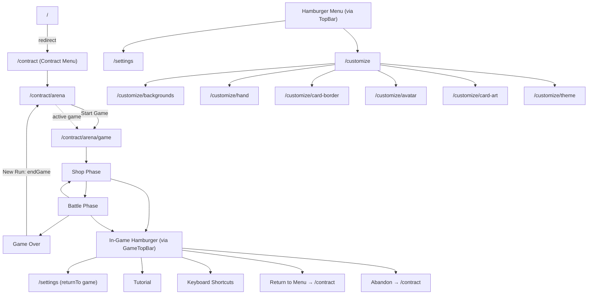

# UI Flow

This document tracks the complete menu and navigation structure of the game. Use it as the source of truth when adding new screens or changing navigation paths.

Last updated: 2026-10-20 (routes in `web/src/main.tsx`). The pallet-era screens (Login, Main Menu, Play, Tournament, Practice, Versus, Sets, Cards, History, Creator Studio, Account, Network, Marketplace) were removed with the pallet runtime. Ranked play, the leaderboard, and badges are on hold until Records exists; their old routes redirect to `/contract`.

## Navigation Flowchart

Unknown routes redirect to `/contract`. The router is a `HashRouter`.

## Global Elements

Mounted once in `web/src/main.tsx`, outside `Routes`: `ThemedToaster`, `TransactionOverlay`, `TutorialOverlay`, `CardInspectOverlay`, `ThemeController`, `ParticleBackground`, and `HamburgerMenu`.

### TopBar (Standard Navigation Bar)

**Component:** `TopBar`

**Layout:** `[<- Back]` ... `[Title]` ... `[Hamburger]`

- **Back button** (left, optional): If the page was reached with `location.state.returnTo` (e.g. via the hamburger menu), the back button uses that as the destination. Otherwise it falls back to the `backTo` prop.
- **Title** (center, optional).
- **Hamburger trigger** (right): Opens the global slide-out menu via `menuStore`.
- **`hasCardPanel`** prop: Adds left margin to clear the card detail sidebar when present.

### GameTopBar (In-Game Navigation Bar)

**Component:** `GameTopBar`, rendered by `GameShell`.

**Contents:**
- Player avatar (if customized)
- Bag button — opens the bag overlay
- Round, wins (current / target), and lives (current / starting)
- **Commit** button (the contract game's `customAction`), with an "Are you sure?" confirmation
- Hamburger trigger (right-aligned) — opens the in-game menu

### Hamburger Menu (Global)

**Component:** `HamburgerMenu`

**Close:** Click backdrop, click X button, or press Escape.

**Standard menu** (non-game routes):

| Label | Icon | Route |
|---|---|---|
| Settings | Gear | `/settings` |
| Customize | Palette | `/customize` |

**In-game menu** (on `/contract/arena/game`):

| Label | Route | Notes |
|---|---|---|
| Settings | `/settings` | Back returns to the game via `returnTo` state |
| Tutorial | — | Opens the tutorial overlay (`how-to-play`) |
| Keyboard Shortcuts | — | Opens the keyboard shortcuts overlay |
| Return to Menu | `/contract` | Leaves the game running on chain |
| Abandon | `/contract` | Confirmation, then `abandonGame` on chain |

## Contract Menu

**Route:** `/contract`

**Component:** `ContractMenuPage`

**Contents:**
- **Connect** — connects the signer: the host product account inside a Polkadot host, dev accounts standalone. Connect sends no transaction.
- Account list (Host or Dev badge) once connected
- **Contract Arena** (`/contract/arena`)
- **End session** (host accounts) — revokes the registry session key (one prompt when the key is live), then returns the key's funds to the player
- **Disconnect**

## Contract Arena

**Route:** `/contract/arena`

**Component:** `ContractArenaPage` — redirects to `/contract` when not connected and to `/contract/arena/game` when a game is active.

**TopBar:** Back to `/contract`, title "Contract Arena"

**Contents:**
- Set 0 ("Foundations of War")
- **Start Game** — casual game (`startGame`). Inside a host, the first write sets up a registry session (one prompt); later game calls need no prompt.

## Arena Game

**Route:** `/contract/arena/game`

**Component:** `ContractArenaGamePage` — renders `GameShell` with the **Commit** action. Redirects to `/contract/arena` when there is no game.

- Shop phase runs in the local WASM engine.
- **Commit** submits the turn (`submitTurn`). The battle overlay replays the battle the contract reported.
- When the run is over, `ContractGameOverScreen` shows. **New Run** calls `endGame`, then returns to `/contract/arena`.

## Customize

**Route:** `/customize` → `/customize/:category`

**TopBar:** Back to `/`, title "Customize". Category pages go back to `/customize`.

| Category | Route slug | Slot |
|---|---|---|
| Background | `backgrounds` | `board_bg` |
| Hand | `hand` | `hand_bg` |
| Card Border | `card-border` | `card_style` |
| Avatar | `avatar` | `avatar` |
| Card Art | `card-art` | `card_art` |
| Theme | `theme` | `theme` |

Category pages list owned NFTs of that slot. Owned-NFT listing waits for the host NftPurse API (`web/src/services/nftOwnership.ts`), so today only the defaults show.

## Settings

**Route:** `/settings`

**TopBar:** Back to `/` (or to the game via `returnTo`), title "Settings"

**Sections:**
- **Display:** Show Card Names, Card Details Panel (Always / Auto / Never), Show Board Helper, Show Address, Show Balance
- **Battle:** Default Battle Speed, Reduced Animations
- **Debug:** Show Raw JSON

## Route Table

| Route | Page | Back to |
|---|---|---|
| `/` | redirect | — |
| `/contract` | Contract Menu | — |
| `/contract/arena` | Contract Arena | `/contract` |
| `/contract/arena/game` | Arena Game | — |
| `/customize` | Customize | `/` |
| `/customize/:category` | Customize Category | `/customize` |
| `/settings` | Settings | `/` or game |
